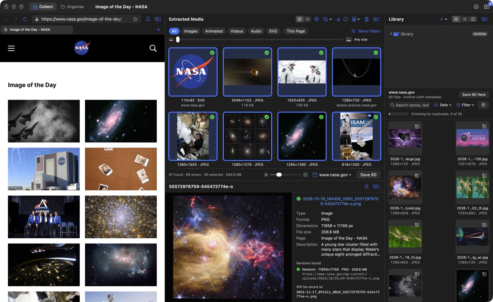

<p align="center">
  
</p>

<h1 align="center">MediaPull</h1>

<p align="center">Save images and videos from the web into your own folders, then find and sort them. A Mac app that never uploads anything.</p>



## Features

- **Collect from any page.** Every image and video on the page appears as you browse, at the largest size. Save with ⌘S.
- **Download from hundreds of sites.** Instagram, YouTube, Bluesky, Pinterest, ArtStation, Imgur and the other sites gallery-dl and yt-dlp support, each with its own options.
- **Search your photos** by what they show, the text in them, places and people. Everything runs on your Mac.
- **Organise any folder** by date, event, subject or person, in place or into a new folder. Undo with ⌘Z.
- **View folders as icons, a list or columns**, as in the Finder (⌘1, ⌘2, ⌘3). Each pane keeps its own view.

| Organise | Downloads |
|---|---|
|  |  |
| **List view** | **Column view** |
|  |  |

## Install

Download the `.dmg` from [Releases](https://github.com/leeyenkai/MediaPull/releases), open it and drag MediaPull to Applications. Needs macOS 26 or later on Apple silicon.

The app is not notarized: the first time, right-click MediaPull and choose Open.

## Build

```bash
./scripts/install-app.sh
```

Needs Xcode 27. Tests: `./scripts/check.sh`. Disk image: `./scripts/make-dmg.sh`. Specification: [docs/SPEC.md](docs/SPEC.md).

## Licences

Bundled: gallery-dl (GPL-2.0), yt-dlp (Unlicense), Python (PSF), ffmpeg (LGPL-2.1), GeoNames (CC BY 4.0) and the analysis models in [docs/spikes/analysis-models.md](docs/spikes/analysis-models.md), some for non-commercial or research use only.
