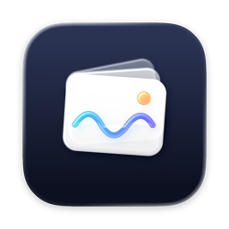
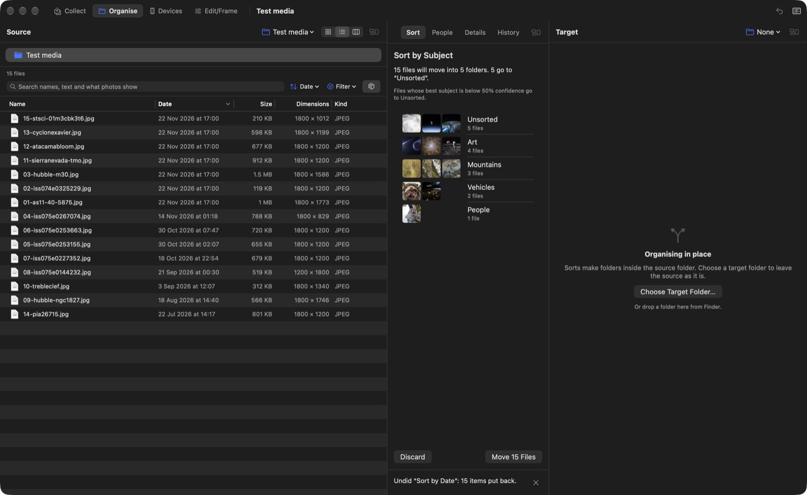
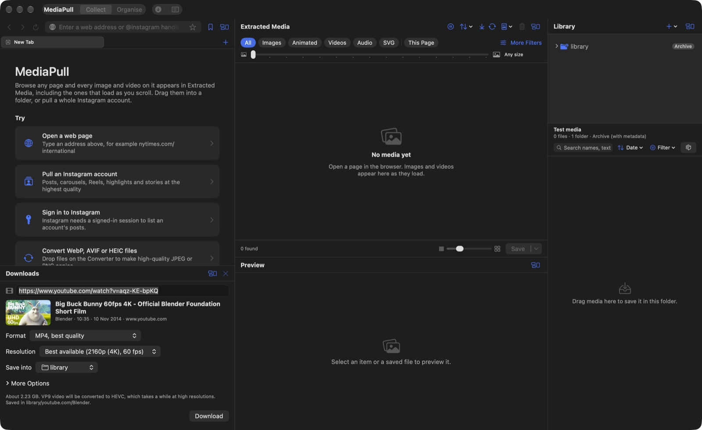
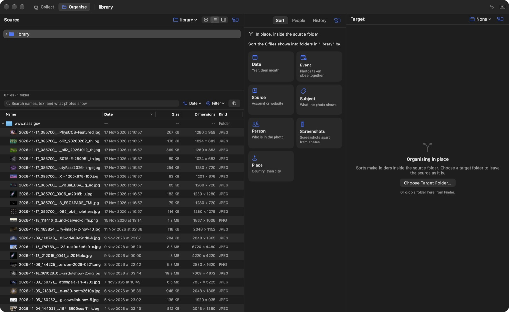
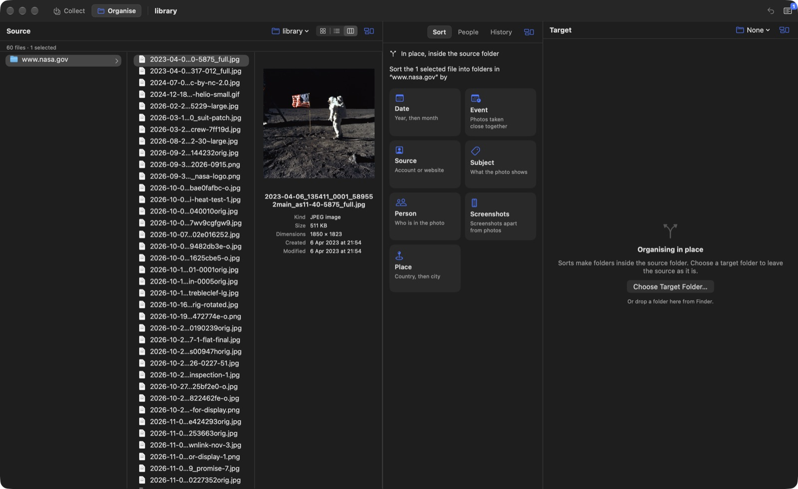
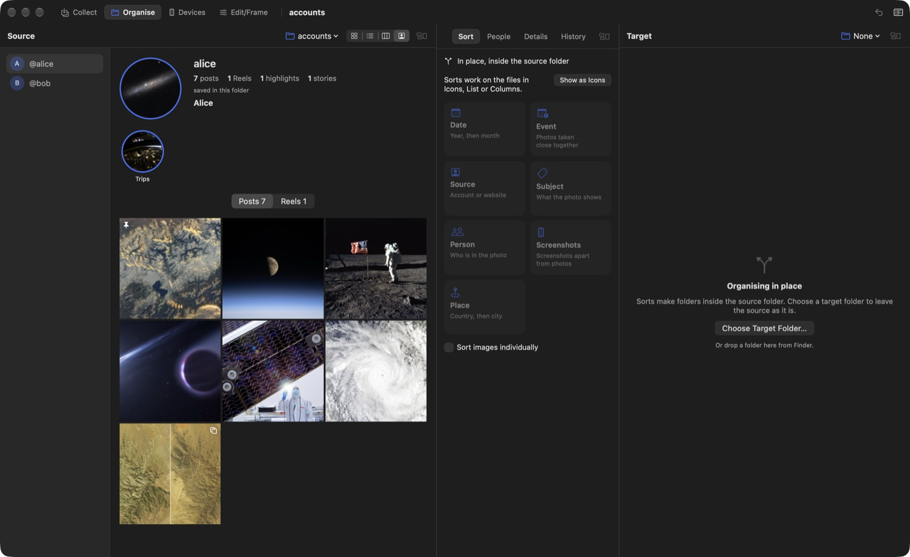
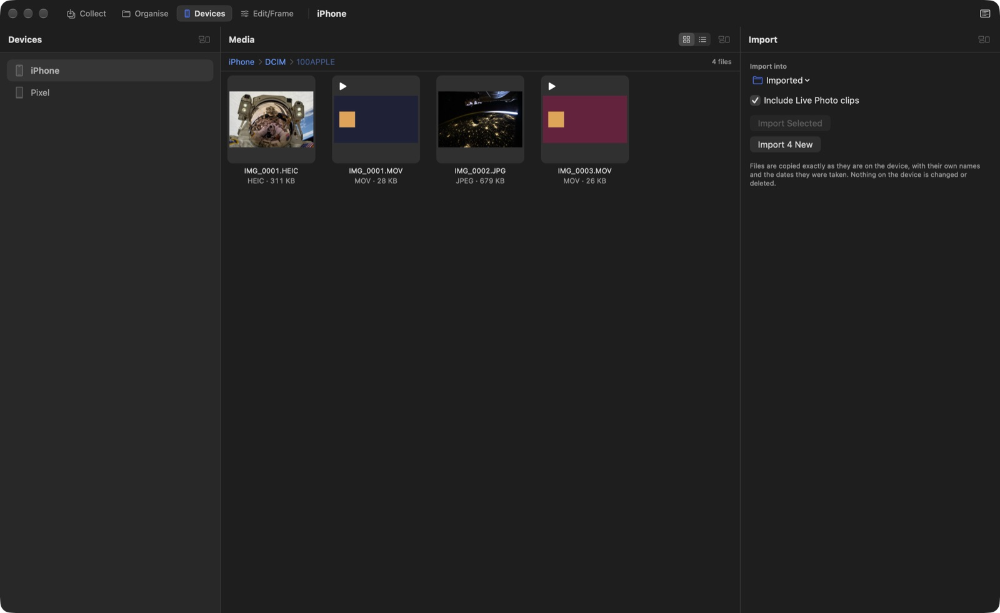
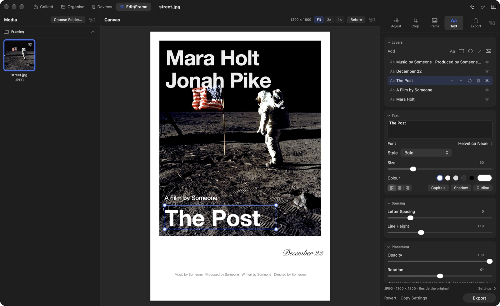

<p align="center">
  
</p>

<h1 align="center">MediaPull</h1>

<p align="center">Collect images, videos and audio from the web, bring them in from phones, cameras and drives, and keep them in order. A Mac app that never uploads anything.</p>


## Features

- **Collect from any page.** Every image and video on the page appears as you browse, at the largest size. Save with ⌘S.
- **Download from hundreds of sites.** Instagram, YouTube, Bluesky, Pinterest, ArtStation, Imgur and the other sites gallery-dl and yt-dlp support, each with its own options.
- **Search your photos** by what they show, the text in them, places and people. Everything runs on your Mac.
- **Organise any folder** by date, event, subject, person, place, artist or album, in place or into a new folder. Undo with ⌘Z. Duplicates and look-alikes are marked in Organise too.
- **Edit and frame photos, videos and audio.** The Edit/Frame section (⌃⌘4) shows its tools as tabs beside the canvas, where you drag, resize and turn text directly. It has simple adjustments, looks, crops for 1:1, 4:5 and 9:16, and frames with a border or a blurred background. Add text in any Mac font (Apple's extra fonts download when you allow it), shapes and logos, or start from a template such as Gallery Border, Polaroid or Poster. Videos can be cut, turned, sped up, faded and framed; audio gets a waveform, cuts, fades, volume and tags, and exports as MP3, M4A, FLAC, WAV or AIFF. Your originals are never changed: edits are kept as a recipe you can reopen, and Export writes a new file.
- **Bring in from phones, cameras and drives.** The Devices section (⌃⌘3) shows an iPhone or Android phone like a drive and copies only what is new. Drives and camera cards appear in Organise by themselves, ready to sort, with Eject.
- **Map & Timeline.** In Organise, see where and when a folder's photos were taken, and select by place or date.
- **Every format, kept as it is.** HEIC (including Fujifilm .hif), camera RAW, Live Photos and audio (MP3, M4A, FLAC, WAV, AIFF, Ogg) are listed, previewed and searched. A RAW and its JPEG, or a Live Photo's photo and clip, are one item that always moves together; your own files are never converted.
- **Fix ratings, keywords, dates and places.** Star photos, add keywords, shift a camera's wrong clock or set the time zone, and set or remove a location, for one photo or many. JPEG and HEIC are changed in the file without touching the picture; RAW and other files get a `.xmp` beside them. Undo with ⌘Z.
- **Instagram posts stay together.** Sorting puts every picture of a post in the same folder, and grids show "2 of 5".
- **View folders as icons, a list or columns**, as in the Finder (⌘1, ⌘2, ⌘3). Each pane keeps its own view.
- **See saved accounts as they looked.** In Organise, a saved Instagram account, YouTube channel, X, Bluesky or Reddit feed or Pinterest board opens as a profile, a channel, a timeline or a board (⌘4), from the saved files only. Captions, places, playlists and highlight covers are kept with new downloads.
- **Save As.** Any download can go exactly into a folder you choose. Only what that folder lacks is added, and nothing goes anywhere else.
- **Photo details.** The Preview pane shows the camera, lens, exposure, when and where a photo was taken, and the nearest place. A map is optional: it loads images from Apple, so it stays off until you click Show Map.
- **Notes.** A scratchpad in the top bar for addresses and reminders, kept in the app.

| Organise | Downloads |
|---|---|
|  |  |
| **List view** | **Column view** |
|  |  |
| **Profile view** | **Devices** |
|  |  |



The screenshots show NASA images, which are in the public domain, NASA's Image of the Day page, and a Blender open movie.

## Install

Download the `.dmg` from [Releases](https://github.com/leeyenkai/MediaPull/releases), open it and drag MediaPull to Applications. Needs macOS 26 or later on Apple silicon.

The app is not notarized: the first time, right-click MediaPull and choose Open.

## Build

```bash
./scripts/install-app.sh
```

Needs Xcode 27. Tests: `./scripts/check.sh`. Disk image: `./scripts/make-dmg.sh`. Specification: [docs/SPEC.md](docs/SPEC.md).

## Licences

Bundled: gallery-dl (GPL-2.0), yt-dlp (Unlicense), Python (PSF), ffmpeg (LGPL-2.1), GeoNames (CC BY 4.0) and the analysis models in [docs/spikes/analysis-models.md](docs/spikes/analysis-models.md), some for non-commercial or research use only.
